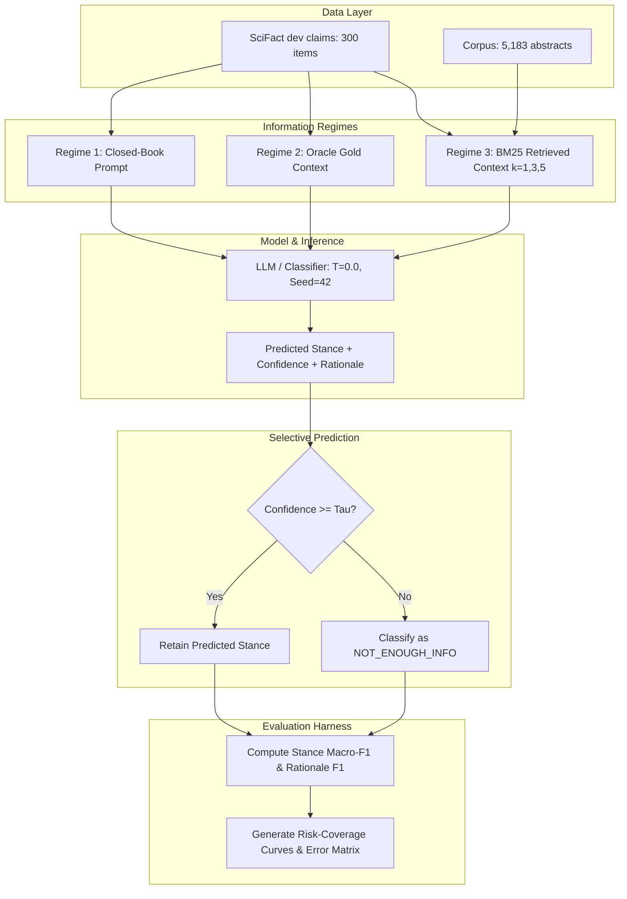

# Frozen Experiment Blueprint & Evaluation Protocol

**Status**: FROZEN (Pre-Execution)  
**Date**: 2026-11-16  
**Primary Research Question**: How does retrieval noise degrade scientific claim stance verification and rationale faithfulness in large language models, and can an explicit confidence-based abstention mechanism (selective prediction) systematically improve the factual reliability of answered claims?

---

## 1. System Architecture & Information Flow



---

## 2. Precise Module Definitions and Input/Output Specifications

### Module 1: Scientific Corpus Indexer & Retriever
- **Inputs**: `corpus.jsonl` (5,183 documents) and claim text $q$.
- **Operation**: Build an inverted BM25 index over `title + " " + " ".join(abstract)`. Compute BM25 scores:
  $$\text{Score}(D, q) = \sum_{t \in q} \text{IDF}(t) \cdot \frac{f(t, D) \cdot (k_1 + 1)}{f(t, D) + k_1 \cdot \left(1 - b + b \cdot \frac{|D|}{\text{avgdl}}\right)}$$
  with standard parameters $k_1 = 1.5, b = 0.75$.
- **Outputs**: Top-$k$ retrieved candidate documents $\{D_{(1)}, \dots, D_{(k)}\}$ where $k \in \{1, 3, 5\}$.

### Module 2: Prompt Formatter & Context Injector
- **Inputs**: Claim $q$, condition tag $\in \{\text{Closed-Book}, \text{Oracle}, \text{Retrieved}\}$, candidate abstract text $A$.
- **Prompt Structure**:
  ```text
  You are an expert scientific fact-checking system.
  Evidence: [EVIDENCE TEXT / NONE]
  Claim: [CLAIM TEXT]

  Determine whether the evidence SUPPORTS, CONTRADICTS, or provides NOT_ENOUGH_INFO for the claim.
  Provide:
  1. Stance: Exactly one of [SUPPORT, CONTRADICT, NOT_ENOUGH_INFO]
  2. Confidence: A numerical probability between 0.0 and 1.0 indicating your certainty.
  3. Rationale: The exact sentence(s) from the evidence directly supporting your stance.
  ```
- **Outputs**: Standardized JSON prompt string.

### Module 3: Model Inference & Parser
- **Inputs**: Formatted prompt string.
- **Decoding Configuration**: Greedy decoding (`temperature = 0.0`, `max_new_tokens = 256`, `seed = 42`).
- **Parser**: Extracts `{stance: str, confidence: float, rationale: str}` with schema validation and strict error fallbacks.

### Module 4: Selective Prediction & Confidence Thresholding
- **Inputs**: Predicted stance $\hat{y} \in \{\text{SUPPORT}, \text{CONTRADICT}, \text{NOT\_ENOUGH\_INFO}\}$ and confidence score $\sigma \in [0.0, 1.0]$.
- **Decision Rule**:
  $$\hat{y}_{\text{selective}} = \begin{cases} \hat{y}, & \text{if } \sigma \ge \tau \\ \text{NOT\_ENOUGH\_INFO}, & \text{if } \sigma < \tau \end{cases}$$
- **Threshold Range**: Swept across $\tau \in \{0.0, 0.2, 0.4, 0.5, 0.6, 0.7, 0.8, 0.9\}$.

### Module 5: Evaluation & Metrics Scorer
- **Inputs**: Predictions dataframe and gold annotations from `claims_dev.jsonl`.
- **Outputs**: Macro-averaged F1, Per-class precision/recall, Rationale token-level F1, Selective accuracy @ coverage, ECE.

---

## 3. Evaluation Metrics & Directionality

| Metric Name | Mathematical Definition | Range | Better |
|---|---|:---:|:---:|
| **Stance Macro-F1** | $\frac{1}{3} \sum_{c \in \{\text{SUP}, \text{CON}, \text{NEI}\}} F1_c$ | $[0.0, 1.0]$ | **Higher ($\uparrow$)** |
| **Stance Accuracy** | $\frac{1}{N} \sum_{i=1}^N \mathbb{I}(\hat{y}_i = y_i)$ | $[0.0, 1.0]$ | **Higher ($\uparrow$)** |
| **Rationale Token-F1** | Harmonic mean of token precision and recall against gold evidence spans | $[0.0, 1.0]$ | **Higher ($\uparrow$)** |
| **Selective Accuracy ($Acc@C$)** | Accuracy computed strictly on retained instances where $\sigma_i \ge \tau$ | $[0.0, 1.0]$ | **Higher ($\uparrow$)** |
| **Coverage ($C$)** | Proportion of evaluation claims retained: $\frac{1}{N} \sum_{i=1}^N \mathbb{I}(\sigma_i \ge \tau)$ | $[0.0, 1.0]$ | Target-dependent |
| **Expected Calibration Error (ECE)** | $\sum_{m=1}^M \frac{|B_m|}{N} |\text{acc}(B_m) - \text{conf}(B_m)|$ for $M=10$ bins | $[0.0, 1.0]$ | **Lower ($\downarrow$)** |
| **Unfaithful Reasoning Rate** | Percentage of claims where stance $\hat{y}_i = y_i$ but Rationale $F1_i == 0.0$ | $[0.0, 1.0]$ | **Lower ($\downarrow$)** |

---

## 4. Deep Analyses Plan (Beyond Aggregate Metrics)

1. **Ablation / Sensitivity to Retrieval Depth ($k$)**:
   - Evaluate system performance systematically as context expands: $k = 0$ (Closed-book), $k = 1$, $k = 3$, $k = 5$, and Oracle.
   - Measures the exact point at which added distractor abstracts saturate or degrade LLM reasoning capacity.
2. **Failure Mode & Error Taxonomy Breakdown**:
   - For every incorrect prediction, categorize into mutually exclusive error buckets:
     * *Type I (Retrieval Failure)*: Gold abstract not in top-$k$; model correctly outputs `NOT_ENOUGH_INFO` or hallucinates stance on distractor.
     * *Type II (Stance Flip)*: Gold abstract retrieved, but model predicts `SUPPORT` when label is `CONTRADICT` (or vice-versa).
     * *Type III (Unfaithful Rationale)*: Stance is correct, but selected rationale sentences have 0% overlap with gold evidence.
     * *Type IV (Overconfident Error)*: Prediction is wrong, but confidence $\sigma \ge 0.80$ (target of Kalai et al., 2026).

---

## 5. Threats to Validity & Mitigation

1. **Internal Validity (Prompt Sensitivity)**:
   - *Threat*: Results could fluctuate if prompts are phrased slightly differently between conditions.
   - *Mitigation*: The system prompt, stance definitions, and output JSON instructions remain byte-for-byte identical across all conditions; only the injected evidence block changes.
2. **Construct Validity (Confidence Formulation)**:
   - *Threat*: Verbalized confidence might reflect linguistic assertiveness rather than true posterior probability.
   - *Mitigation*: Evaluate calibration with ECE and compare verbalized confidence against normalized logit margin where model access permits.
3. **External Validity (Domain Generalization)**:
   - *Threat*: SciFact focuses heavily on biomedical and clinical literature.
   - *Mitigation*: Clearly bound findings to scientific and biomedical claims; discuss generalizability constraints in paper limitations.

---

## 6. Pre-Experiment Protocol Freeze Checklist

- [x] Primary evaluation dataset frozen: `claims_dev.jsonl` (300 items).
- [x] Primary metrics frozen: Stance Macro-F1 and Selective Accuracy vs. Coverage.
- [x] Conditions frozen: Closed-book vs. Oracle vs. BM25 ($k \in \{1, 3, 5\}$).
- [x] Random seeds frozen: 42 (primary), with seeds 123 and 456 reserved for multi-run stability checks.
- [x] Decoding parameters frozen: `temperature = 0.0` (deterministic greedy).
- [x] Change Logging Rule: Any post-hoc modification to prompt, metric definitions, or thresholds must be documented in `research_decisions.md` with explicit justification before re-evaluating.
