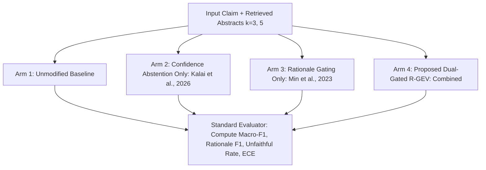

# Experimental Comparison and Ablation Plan (Prompt 12)

**Project**: Benchmarking Factual Accuracy of Large Language Models Across Scientific Domains  
**Proposed Intervention**: Rationale-Grounded Evidence Verification (R-GEV)  
**Date**: 2026-11-17  
**Status**: FROZEN PLAN (Pending Student Authorization to Execute)

---

## 1. Experimental Conditions (Ablation Design)

To evaluate the contribution scientifically without confounding variables, we design a **4-Arm Ablation Study** evaluated across the identical 300 SciFact dev claims under BM25 retrieval ($k=3$ and $k=5$):

### Detailed Arm Definitions:
1. **Arm 1: Unmodified Baseline (Control)**:
   - Evaluates claims using standard top-$k$ BM25 retrieval without rationale verification or confidence thresholding.
   - Purpose: Serves as the historical reference baseline established in Prompt 11.
2. **Arm 2: Confidence-Based Selective Prediction Only (Kalai et al., 2026)**:
   - Uses the unverified rationale, but applies confidence thresholding: if $\sigma < \tau$, output `NOT_ENOUGH_INFO`.
   - Purpose: Isolates whether confidence thresholding alone can eliminate unfaithful reasoning.
3. **Arm 3: Rationale-Grounded Verification Only (FActScore / Min et al., 2023)**:
   - Evaluates whether the maximum sentence overlap ratio surpasses $\theta \in [0.25, 0.50]$. If no sentence meets threshold $\theta$, output `NOT_ENOUGH_INFO` regardless of confidence.
   - Purpose: Isolates the direct effect of atomic evidence verification on suppressing distractor interference.
4. **Arm 4: Proposed Dual-Gated R-GEV (Full Proposed System)**:
   - Combines both mechanisms: an active stance is asserted **if and only if** sentence support $\ge \theta$ **AND** confidence $\ge \tau$. Otherwise, the system safely abstains (`NOT_ENOUGH_INFO`).
   - Purpose: Evaluates the synergistic hypothesis that factual accuracy requires both evidence grounding and confidence calibration.

---

## 2. Evaluation Metrics and Decision Criteria

| Metric | Target / Decision Rule | Direction | Success Threshold |
|---|---|:---:|:---:|
| **Unfaithful Reasoning Rate** | Primary verification metric | **$\downarrow$ Lower is better** | Reduce unfaithful rate by $\ge 40\%$ relative to Arm 1 (from 36.29% to $\le 21.0\%$). |
| **Stance Macro-F1** | Overall 3-class classification | **$\uparrow$ Higher is better** | Preserve or improve Macro-F1 relative to Arm 1 ($\ge 0.2719$). |
| **Rationale Token-F1** | Sentence-level evidence quality | **$\uparrow$ Higher is better** | Increase mean rationale F1 on asserted claims ($\ge 0.3500$). |
| **Selective Accuracy @ 50% Coverage** | Precision on confident claims | **$\uparrow$ Higher is better** | Reach $\ge 60.0\%$ selective accuracy at 50% coverage. |
| **Expected Calibration Error (ECE)** | Alignment of confidence & truth | **$\downarrow$ Lower is better** | Decrease ECE below 0.3000. |

---

## 3. Hypotheses and Falsification Rules

* **Scientific Hypothesis**: Distractor accumulation under open retrieval corrupts LLM reasoning primarily because models draw conclusions from low-support sentences. Requiring an atomic rationale verification threshold $\theta$ will eliminate false positive stances on distractor papers, sharply reducing the unfaithful reasoning rate without destroying classification recall.
* **Falsification / Contradictory Observation**:
  * If Arm 3 and Arm 4 reduce the unfaithful rate only by reducing coverage to near zero (over-abstaining on true positive claims), the hypothesis is refuted.
  * If distractor sentences consistently achieve high lexical support scores ($\ge \theta$), proving that simple overlap cannot distinguish true evidence from topical distractors.

---

## 4. Failure Mode & Error Taxonomy Tracking

For every test claim across all 4 arms, errors will be logged in `results/ablation_error_log.json` under:
* **Type I**: Retrieval failure (Gold abstract not in top-$k$).
* **Type II**: Stance flip (Evidence present, but model inverted Support/Contradict).
* **Type III**: Unfaithful reasoning (Correct stance, but wrong rationale sentence).
* **Type IV**: Overconfident hallucination (Incorrect stance with confidence $\ge 0.80$).
* **Type V (New)**: False Abstention (Gold evidence was present and sufficient, but R-GEV mistakenly rejected it).
